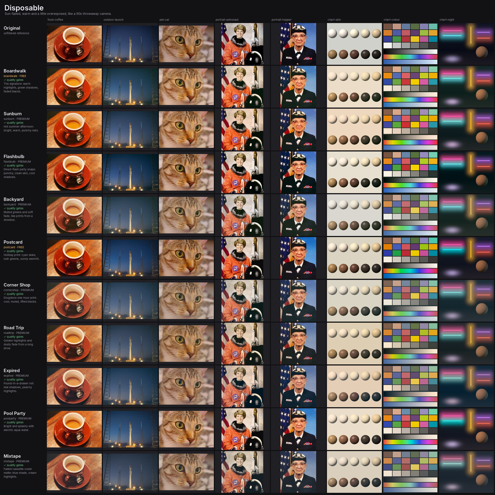
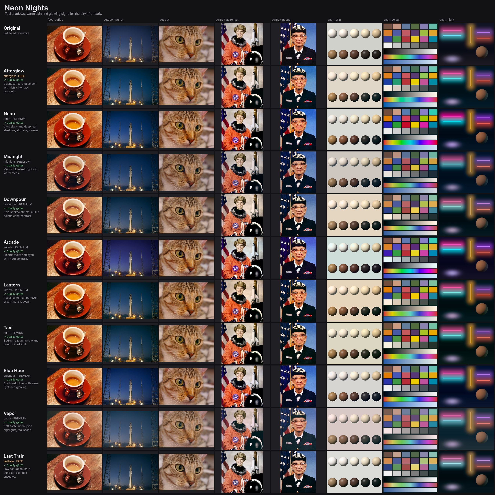
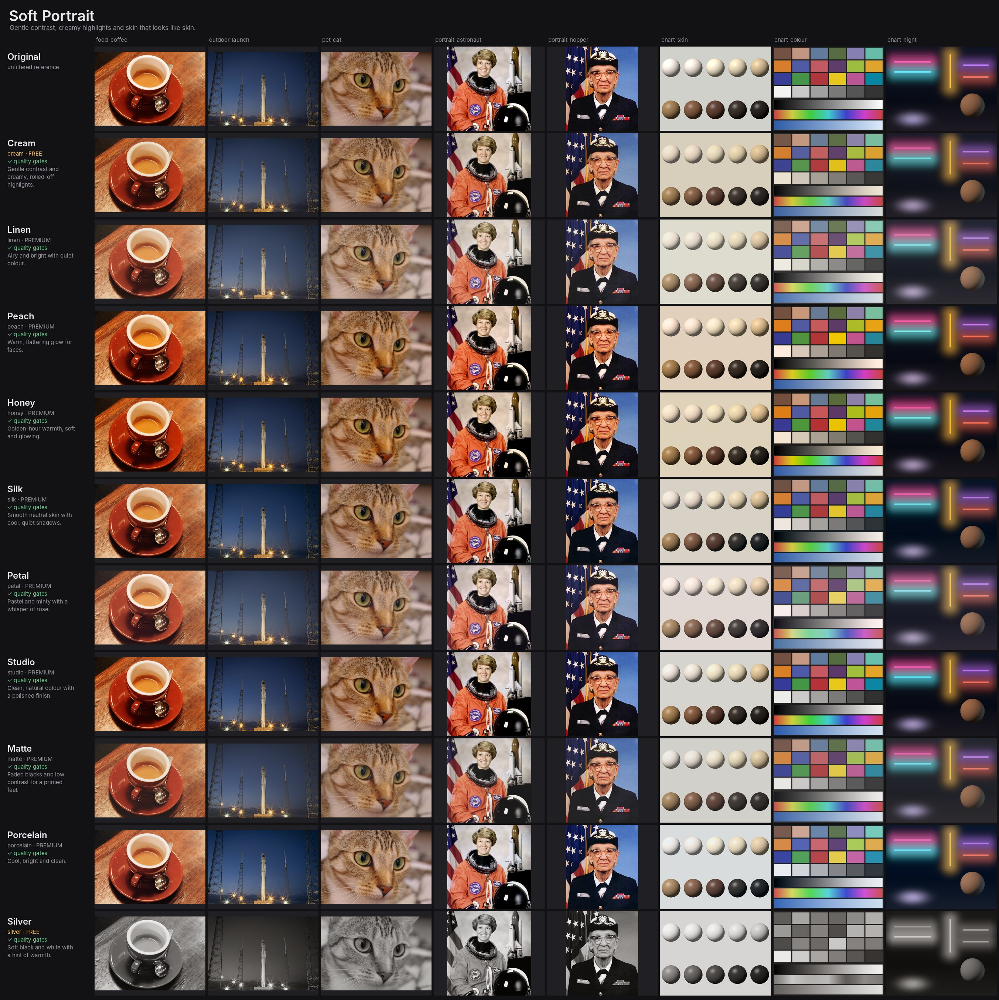

# Filter review

Contact sheets for every look, rendered through the exact `.cube` files the app ships.
Each sheet shows one style direction: rows are looks, columns are the photos in
`test-photos/` plus three synthetic charts (skin tones, colour checker + gradients, neon night).

To approve or reject, edit the **Verdict** column below (or just tell me which looks to drop).
Regenerate after changing `tools/lutgen/looks.toml` or adding photos:

```sh
python3 tools/lutgen/lutgen.py build    # rewrite the .cube files
python3 tools/lutgen/lutgen.py review   # rewrite these sheets
```

Quality gates (all must pass to ship): monotonic tone, no crushed shadows, no clipped
highlights, natural skin across the Monk scale (no orange, magenta or grey shift), and no
banding on smooth 8-bit gradients. The numbers are explained in `tools/lutgen/quality.py`.

## Disposable

_Sun-faded, warm and a little overexposed, like a 90s throwaway camera._



| Look | Tier | Gates | Shadows | Highlights | Skin hue shift | Skin chroma | Verdict |
|---|---|---|---|---|---|---|---|
| **Boardwalk** — The signature: warm highlights, green shadows, faded blacks. | free | ✅ | 0.088 | 0.025 | -2.1° … +8.1° | ×1.01 … ×1.32 |  |
| **Sunburn** — Hot summer afternoon: bright, warm, punchy reds. | premium | ✅ | 0.105 | 0.023 | -4.6° … +6.7° | ×1.16 … ×1.44 |  |
| **Flashbulb** — Direct-flash party snaps: punchy, clean skin, cool shadows. | premium | ✅ | 0.099 | 0.028 | -2.1° … +6.6° | ×0.95 … ×1.22 |  |
| **Backyard** — Muted greens and soft fade, like prints from a shoebox. | premium | ✅ | 0.100 | 0.027 | +0.0° … +9.3° | ×0.84 … ×0.89 |  |
| **Postcard** — Holiday print: cyan skies, lush greens, sunny warmth. | free | ✅ | 0.095 | 0.041 | -1.7° … +2.0° | ×1.16 … ×1.30 |  |
| **Corner Shop** — Drugstore one-hour print: cool, muted, lifted blacks. | premium | ✅ | 0.105 | 0.028 | +0.0° … +6.6° | ×0.78 … ×1.06 |  |
| **Road Trip** — Golden highlights and dusty fade from a long drive. | premium | ✅ | 0.092 | 0.037 | -1.8° … +7.1° | ×0.86 … ×1.35 |  |
| **Expired** — Found-in-a-drawer roll: teal shadows, peachy highlights. | premium | ✅ | 0.097 | 0.027 | -6.0° … +0.0° | ×0.77 … ×1.23 |  |
| **Pool Party** — Bright and splashy with electric aqua water. | premium | ✅ | 0.112 | 0.024 | -2.5° … +1.6° | ×1.10 … ×1.31 |  |
| **Mixtape** — Faded cassette-cover matte: blue shade, cream highlights. | premium | ✅ | 0.070 | 0.034 | -3.2° … +3.4° | ×0.69 … ×1.07 |  |

## Neon Nights

_Teal shadows, warm skin and glowing signs for the city after dark._



| Look | Tier | Gates | Shadows | Highlights | Skin hue shift | Skin chroma | Verdict |
|---|---|---|---|---|---|---|---|
| **Afterglow** — Balanced teal and amber with rich, cinematic contrast. | free | ✅ | 0.107 | 0.038 | -2.1° … +3.9° | ×0.80 … ×1.22 |  |
| **Neon** — Vivid signs and deep teal shadows; skin stays warm. | premium | ✅ | 0.185 | 0.035 | -2.6° … +3.2° | ×0.96 … ×1.17 |  |
| **Midnight** — Moody blue-teal night with warm faces. | premium | ✅ | 0.087 | 0.058 | -8.5° … +0.8° | ×0.69 … ×0.92 |  |
| **Downpour** — Rain-soaked streets: muted colour, crisp contrast. | premium | ✅ | 0.194 | 0.043 | -3.7° … +6.4° | ×0.73 … ×1.19 |  |
| **Arcade** — Electric violet and cyan with hard contrast. | premium | ✅ | 0.180 | 0.037 | -6.2° … +9.6° | ×0.83 … ×1.14 |  |
| **Lantern** — Paper-lantern amber over green-teal shadows. | premium | ✅ | 0.198 | 0.040 | -2.6° … +9.3° | ×0.88 … ×1.41 |  |
| **Taxi** — Sodium-vapour yellow and green mixed light. | premium | ✅ | 0.198 | 0.043 | +0.0° … +10.1° | ×0.88 … ×1.29 |  |
| **Blue Hour** — Cool dusk blues with warm lights left glowing. | premium | ✅ | 0.193 | 0.034 | -6.1° … +0.9° | ×0.84 … ×1.14 |  |
| **Vapor** — Soft pastel neon: pink highlights, teal shade. | premium | ✅ | 0.097 | 0.049 | -7.2° … +3.8° | ×0.80 … ×0.92 |  |
| **Last Train** — Low saturation, hard contrast, cold teal shadows. | free | ✅ | 0.188 | 0.040 | -2.2° … +7.0° | ×0.71 … ×0.84 |  |

## Soft Portrait

_Gentle contrast, creamy highlights and skin that looks like skin._



| Look | Tier | Gates | Shadows | Highlights | Skin hue shift | Skin chroma | Verdict |
|---|---|---|---|---|---|---|---|
| **Cream** — Gentle contrast and creamy, rolled-off highlights. | free | ✅ | 0.108 | 0.036 | -1.3° … +1.5° | ×0.94 … ×1.20 |  |
| **Linen** — Airy and bright with quiet colour. | premium | ✅ | 0.118 | 0.029 | -0.1° … +1.5° | ×0.83 … ×1.01 |  |
| **Peach** — Warm, flattering glow for faces. | premium | ✅ | 0.208 | 0.042 | -3.9° … +1.8° | ×1.06 … ×1.26 |  |
| **Honey** — Golden-hour warmth, soft and glowing. | premium | ✅ | 0.207 | 0.035 | -2.0° … +1.7° | ×1.09 … ×1.35 |  |
| **Silk** — Smooth neutral skin with cool, quiet shadows. | premium | ✅ | 0.201 | 0.040 | -2.2° … +0.6° | ×0.83 … ×1.10 |  |
| **Petal** — Pastel and minty with a whisper of rose. | premium | ✅ | 0.119 | 0.031 | -5.4° … +0.0° | ×0.83 … ×0.85 |  |
| **Studio** — Clean, natural colour with a polished finish. | premium | ✅ | 0.207 | 0.040 | -1.4° … +1.3° | ×0.98 … ×1.09 |  |
| **Matte** — Faded blacks and low contrast for a printed feel. | premium | ✅ | 0.072 | 0.037 | -2.2° … +4.3° | ×0.82 … ×0.93 |  |
| **Porcelain** — Cool, bright and clean. | premium | ✅ | 0.215 | 0.027 | -3.4° … +1.8° | ×0.81 … ×0.88 |  |
| **Silver** — Soft black and white with a hint of warmth. | free | ✅ | 0.110 | 0.038 | +0.0° … +0.0° | ×0.00 … ×0.00 |  |

